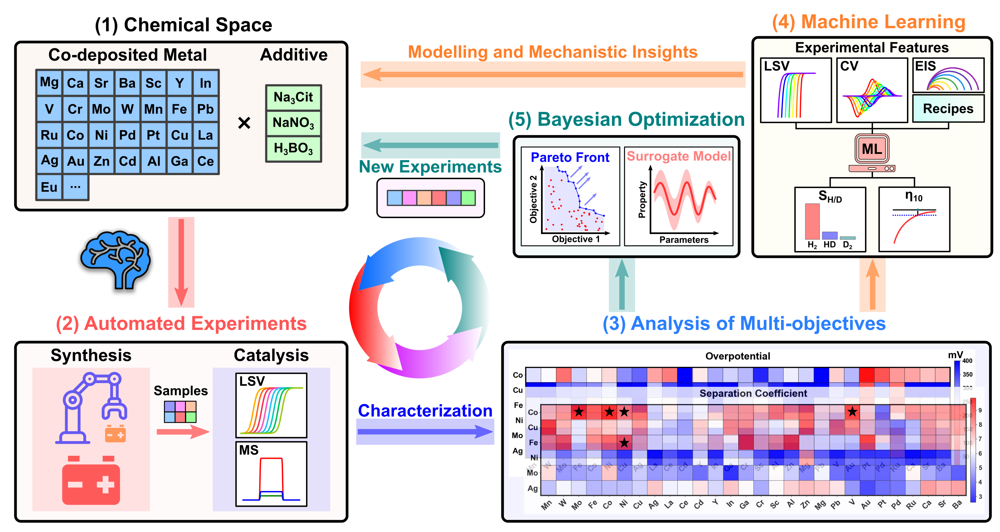
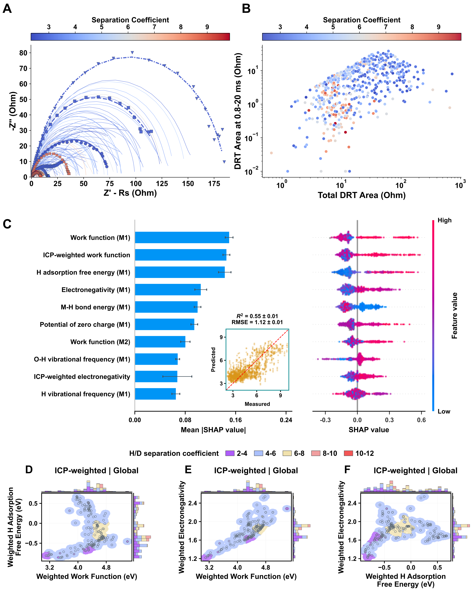
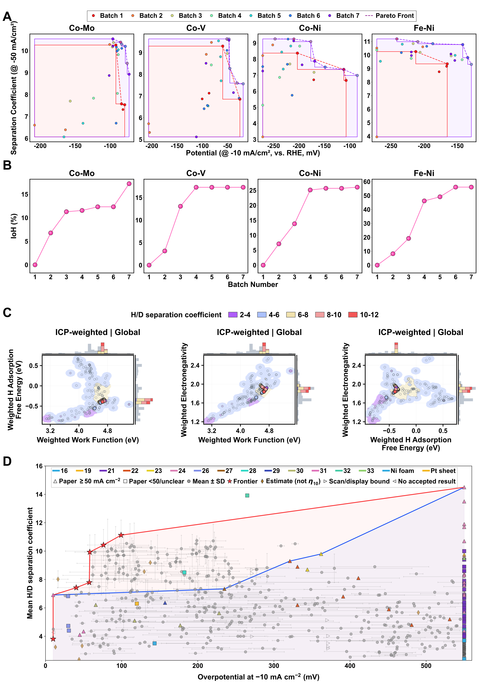

# Data and Code for Electrochemical H/D Separation

Data, analysis scripts, machine-learning results and platform-control code for
the electrochemical H/D separation study. Each analysis package has its own
inputs, outputs and reproduction commands; this is not one installable application.

## Publication Entry Points

| Content | Location |
| --- | --- |
| Correlation-aware ML, validation, SHAP and correlations | [ml_revision](ml_revision/README.md) |
| NMR, mass spectrometry and experimental repeatability | [others_revision](others_revision/README.md) |
| LSV extraction and per-catalyst activity statistics | [LSV analysis](0-Figures/Figure1/revision_figure/README.md) |
| Initial and repeated raw LSV measurements | [LSV_repeat](hd_separation_ml/data_extraction/all_data/LSV_repeat/README.md) |
| Assembled manuscript figures and panel sources | [Manuscript figures](0-Figures/manuscript/README.md) |
| Data cohorts and source tables | [Data manifest](DATA_MANIFEST.md) |

Analysis assets are named by content, independently of SI or response-letter
figure numbers. The current reported ML results are in `ml_revision/results/`.
Acquisition and BO notebooks elsewhere in the repository support data provenance;
they are not alternative entry points for the reported nested-validation results.

## Manuscript Figures

Use the assembled files below for the manuscript. The numbered source folders
under `0-Figures/` contain panel dependencies, not alternative complete figures.
See the [panel source map](0-Figures/manuscript/README.md) for reproduction.

### Figure 1: Automated Experimental Platform

[Editable SVG](0-Figures/manuscript/Figure1.svg) | [PDF](0-Figures/manuscript/Figure1.pdf)



### Figure 3: Characterization, SHAP and Global Descriptor Maps

[Editable SVG](0-Figures/manuscript/Figure3.svg) | [PDF](0-Figures/manuscript/Figure3.pdf)



### Figure 4: BO Performance and Activity/Separation Comparison

[Editable SVG](0-Figures/manuscript/Figure4.svg) | [PDF](0-Figures/manuscript/Figure4.pdf)

Panel D includes experimental mean and SD for both activity and H/D separation.



## Machine Learning

- H/D separation uses 560 initial-screening samples, with random-stratified and
  unseen-pair validation. The with-BO comparison adds 111 eligible observations
  to training only; 37 BO reference measurements are excluded from ML.
- Three repeats of fivefold outer validation and threefold inner validation use
  recorded folds and seeds. Same-recipe/ICP overlap checks cover training,
  validation and test partitions.
- Thirty material descriptors undergo training-only correlation grouping and
  representative selection. Inner validation selects model size and parameters;
  all-input benchmarks use matched folds.
- The activity comparison uses 298 matched catalysts, initial-LSV versus
  averaged crossing-only targets, and a 10-550 mV target cap. No paired
  electrochemical measurements are used as activity-model inputs.
- Paired LSV/EIS/Et descriptors are acquisition-matched in the separate H/D
  electrochemical-configuration comparison.

Install the package's pinned requirements, then verify the saved results without
fitting models:

```powershell
cd ml_revision
python reproduce.py --check-only
```

For a full refit or figure regeneration, follow the [ML instructions](ml_revision/README.md).
The [reporting map](ml_revision/REPORTING_MAP.md) links each result to its script.

## Experimental Analyses

Raw LSV, EIS, CV20 and Et exports are under
`hd_separation_ml/data_extraction/all_data/`. The repeated LSV manifest records
file hashes, sample identity and electrode area. Crossings, rising/nearest-point
estimates and scan limits remain distinct in the extraction records.

Experimental crossing means and sample SDs are not capped. Same-recipe reference
measurements remain in the repeatability summaries and activity/separation plot;
they are excluded from averaged ML targets. The [LSV rules](0-Figures/Figure1/revision_figure/README.md)
and [joint repeatability analysis](others_revision/reproducibility_overview/README.md)
document the calculations and pooling.

NMR and MS checks can be run from the repository root without regenerating results:

```powershell
python others_revision/run.py --verify-only
python others_revision/index_publication_assets.py --check
```

The six-property SI descriptor atlas is retained under
`ml_revision/figures/si_candidates/six_weighted_descriptor_pairs/`.
Editable SVGs and PDF/PNG exports are included. Shared typography handling is in
`0-Figures/figure_typography.py`.

## Bayesian Optimization and Hardware

The recorded four-system performance table is
`0-Figures/Figure4/curated/figure4_bo_complete_112.csv`: 28 experiments each for
Co-Mo, Co-V, Co-Ni and Fe-Ni. These observations remain separate from retrospective
repeatability summaries. See [BO provenance](EC_tool_sys/BO_PROVENANCE.md),
[platform manager](EC_tool_sys/manager/README.md) and
[BO implementation](EC_tool_sys/botorch_test/README.md).

`EC_tool_sys/manager/` controls physical equipment and assumes configured COM
ports, instrument drivers, vendor software and robotic hardware. Do not run it
without verifying the intended laboratory setup and safety procedures.

## Contact

- Yibin Jiang: `yibinjiang@xmu.edu.cn`
- Cheng Wang: `wangchengxmu@xmu.edu.cn`
