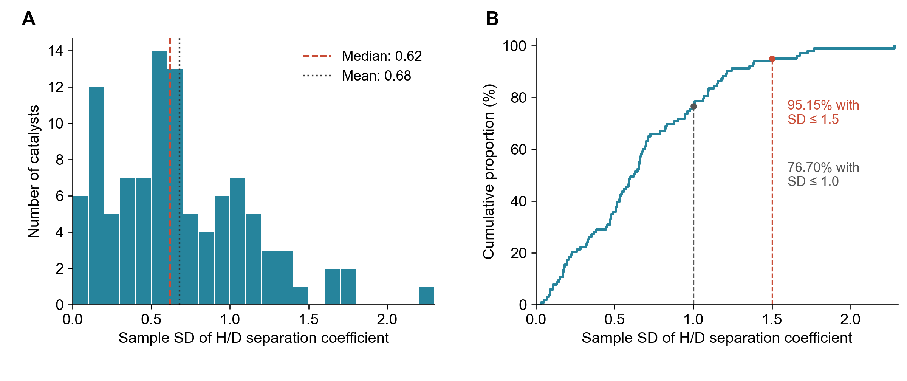

# H/D Separation Coefficient Repeatability

Updated 25 October 2026. This standalone analysis uses the already
adopted coefficient table. It does not change Figure 1B, ML targets, the working
SI/manuscript/response letter, or any instrument file. No excluded measurement
has been reinstated.

## Results

The adopted table contains 800 coefficients. Including the six original-only
pure-metal values gives 806 coefficients for 672 catalysts. Of these, 103
catalysts have repeated measurements and contribute 237 coefficients; the other
569 catalysts have one value and no estimable sample SD.

| Measurements per catalyst | Catalysts | Coefficients | Enters SD distribution |
|---|---:|---:|---|
| 1 | 569 | 569 | No |
| 2 | 98 | 196 | Yes |
| 8 | 4 | 32 | Yes |
| 9 | 1 | 9 | Yes |

Across the 103 catalysts with repeat measurements:

- Median sample SD: **0.62**; interquartile range **0.33-0.97**.
- Mean sample SD: **0.68**.
- Median relative SD (100 x SD / mean): **7.40%**.
- 79/103 catalysts (**76.70%**) have SD at most 1.
- 98/103 catalysts (**95.15%**) have SD at most **1.5**.
- 74/103 catalysts (**71.84%**) have relative SD at most 10%.
- Maximum SD: **2.28**, for Co-Fe21 (8.36778 and 11.58839).

These are dimensionless separation-coefficient SDs, not mV. The relative SD
provides a scale-normalized description. Numerical SDs cannot be compared
directly with the LSV SDs in mV.

All catalysts are treated identically. Measurements with matching documented
precursor recipes are pooled once, without a separate plotting category.
The complete per-catalyst means, SDs and counts are in `tables/sample_statistics.csv`.



The figure shows the absolute SD histogram and empirical cumulative distribution,
matching the LSV presentation. The observed 95% coverage cutoff is the 98th
smallest SD, 1.48795773. The readable reporting threshold of 1.5 includes exactly
the same 98 catalysts (95.15%); percentages are evaluated at the plotted threshold.
It is not an absolute pairwise difference or a confidence interval. Relative-SD
statistics remain available in the tables but are not used for the second panel.

## Where the Data Are

- Additional measurements: the Z: project directory
  `HD_separation/SI_data/error_bar/S`, batches 29-36. It contains nine MS CSVs
  covering 113 measurement groups: 87 adopted and 26 previously excluded.
- Another 17 adopted added/revised coefficients trace to initial-screening MS
  CSVs file293, file294, file295 and file309 under
  `Z:/0-data/H-D_splitting/Raw Data/4-manual/robotic_arm/0-initial/`.
- The source-linked local export is
  `revision-response/HD_separation/revision_response/analysis/electrochemical/inputs/instrument_exports/repeated_HD_S_raw/`.
  Its raw copies and extraction tests remain there; this folder only snapshots
  the numerical evidence needed to reproduce the repeatability review.
- The old GitHub initial table is
  `C:/Users/yibinjiang/Documents/GitHub/HD_separation/0-Figures/Figure1/data/figure1_bottom_this_work_from_all_data.csv`.
  All 709 H/D values match the frozen initial-submission table exactly.
- Complete absolute source paths and checksums are retained in
  `source_manifest.json`, `data/raw_source_manifest.json` and
  `tables/measurement_sources.csv`.

The current Z: summary workbook matches the latest audited snapshot. All 32
checked raw CSV/JSON source files, including calibration files, match their
snapshots. The six existing source-export tests passed, including a relocated
raw-data replay. All 104 added/revised adopted values agree with the saved
last-two-injection means within 0.00000497 (summary rounding).

The initial values and previously grouped reference values are accepted from
the initial table; this is not a new raw replay of every original coefficient.

## Calculation and Replicate Definition

Each MS measurement is represented by the mean of the last two usable
injections, following the earlier confirmed rule. Cu-V uses its two actually
recorded usable injections after the failed first injection. Those injections
are technical readings of one measurement, not two independent catalyst repeats.

For each injection the existing calibrated calculation is
`S_HD = (2*q_H2 + q_HD) / q_HD / 9`, with calibrated quantities obtained from
background-corrected plateau signals. The audit used calibration file492 for
the supplementary S series and file272 for the 17 reprocessed measurements.
No new calibration or raw-signal processing is introduced here.

Catalyst means and SDs use the adopted coefficients with denominator n-1 for SD.
An old value that was replaced is not added again as a further replicate.
In particular, Fe-Ca, Fe-Sc, Fe-Sr, Fe-Ni22, Co-Ni0 and Co-Ni17 retain the two
adopted values, without their superseded initial coefficient. Co-Mo10 retains
the adopted 11.87838 measurement; the rejected alternatives are not restored.
The duplicated Co-Fe31 spreadsheet entry is not counted twice.

The 14 original-plus-reprocessed pairs have the author's explicit confirmation
that they represent independent samples. This confirmation does not turn their
two technical injections into independent experimental repeats.

For the 104 raw-linked adopted measurements, the median technical-injection SD
is 0.21 and median technical-injection relative SD is 2.26%. These describe a
different level of variation, and a different cohort, from the 103 catalysts
with repeated measurements. Do not substitute them for the experimental error bars or
subtract them to claim a variance decomposition.

## Interpretation and SI Draft Text

The SD distribution is descriptive for the adopted measurements. It includes
different runs and calibration batches, not a uniform identical-condition
precision study. With 98 catalysts having only two measurements, individual SDs
are uncertain. The original adoption/exclusion policy remains in force; this
review does not establish that all acquired measurements were included or
reassess the experimental reasons for the 26 exclusions.

Text for SI integration; these findings also support response H/D repeatability:

> H/D separation-coefficient variability was assessed across 103 catalysts
> with at least two adopted measurements. Ninety-eight catalysts had two
> measurements, four catalysts had eight and one catalyst had
> nine. Each coefficient was treated as a measurement-level result; technical
> MS injections used to calculate that coefficient were not counted as
> independent repeats. The median sample SD was 0.62 (interquartile
> range 0.33-0.97); 76.70% of catalysts had an SD of at most 1.00, and 95.15%
> had an SD of at most 1.5. Catalysts with a single measurement were not
> assigned an SD of zero. These statistics describe variation across the
> adopted measurements and acquisition/calibration batches.

Keep this H/D repeatability discussion separate from the decision to use the
original H/D outcome in Figure 1B and the manuscript ML workflows. Reviewing
these repeats does not authorize replacing those outcomes with repeated means.

### Grouping Note

The aliases in `../reproducibility_overview/recipe_evidence.json` pool matching
Co-Fe, Co-Mo, Co-Ni, Co-V and Fe-Ni recipes. Source labels remain in the
measurement-source table, and measurement IDs are unique. There are 672
catalysts after pooling, matching the LSV plotting identities. Individual
coefficient values and the adoption/exclusion policy are unchanged.

## Contents and Reproduction

- `data/`: frozen adopted coefficients, initial values, source/measurement
  manifests, injection results and the independence confirmation.
- `tables/sample_statistics.csv`: n, mean, SD, relative SD and values per catalyst.
- `tables/SD_distribution_thresholds.csv`: exact plotted thresholds and percentages.
- `tables/measurement_sources.csv`: every adopted coefficient and its source.
- `tables/reference_groups.csv`, `largest_SD_groups.csv`: focused review tables.
- `tables/technical_injections.csv`: separate within-measurement statistics.
- `tables/excluded_measurements.csv`: the 26 excluded records, not used in SDs.
- `figures/HD_repeatability_distribution.{png,pdf,svg}`: Arial SD histogram and cumulative distribution.

From this folder, using Python with NumPy, Matplotlib and Arial installed:

```bash
python analyze.py
python plot_distribution.py
```

These use local frozen tables, not Z:. To additionally check the instrument
source hashes when the drive is available:

```bash
python analyze.py --verify-sources
```

No run-record or received-assets directories are created. This is a review
package, not part of the NMR/MS response-figure runner in the parent directory.
